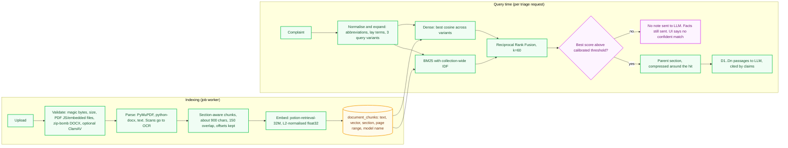

# TriageFlow: PatientTriage.ai

TriageFlow is an Emergency Department (ED) triage assistant. A nurse enters the complaint and vitals, and the system returns an Emergency Severity Index (ESI) level, a confidence breakdown, the reasons behind the level, and the parts of the patient's record it relied on. The nurse can accept the level or override it, and every step is written to an audit trail.

The design rule is simple: the system may raise acuity on its own, but it can never lower it below a deterministic safety floor. When data is missing, it says so and flags the visit for review instead of guessing.

---

## Problems this is built around

### 1. Asymmetric cost of errors
Missing a critical patient is worse than over-triaging a minor one. The final level is `min(base level, rule floor)`. Hard clinical rules (for example low SpO2, or chest pain with an anticoagulant on file) set a floor that neither the ML model nor the LLM can go below. Only a senior role (charge nurse or physician) can override below that floor, and the override is audited.

### 2. Age and sex change what a vital sign means
A temperature of 38.5 C means different things for a 3-year-old and a 75-year-old. Age, sex and vitals are passed to the ML model and the LLM, and the rules use age-banded thresholds.

### 3. Patients with little or no history
Walk-ins with no records are scored on vitals and complaint alone. The confidence breakdown shows that history was missing, and retrieval returns nothing instead of weak matches.

### 4. Patients get worse while they wait
The queue monitor compares wait time to a per-ESI limit and flags patients as "Needs Reassessment". A demo "Fast-Forward Time" control (charge nurse and admin) speeds this up to show a surge.

### 5. Urban and rural facilities
Facility settings change routing rules (for example, a CT scanner being offline). Visits and users are scoped by facility.

---

## System architecture

```mermaid
%%{init: {'theme': 'default', 'themeVariables': { 'edgeLabelBackground':'#ffffff', 'textColor': '#000000'}}}%%
flowchart TD
    linkStyle default stroke:#94a3b8,stroke-width:2px,color:#0f172a;

    classDef user fill:#e2e8f0,stroke:#64748b,stroke-width:2px,color:#0f172a,font-weight:bold
    classDef frontend fill:#eff6ff,stroke:#3b82f6,stroke-width:2px,color:#1e3a8a
    classDef backend fill:#f0fdf4,stroke:#22c55e,stroke-width:2px,color:#14532d
    classDef ai fill:#fdf4ff,stroke:#d946ef,stroke-width:2px,color:#701a75
    classDef storage fill:#fffbeb,stroke:#f59e0b,stroke-width:2px,color:#78350f
    classDef ops fill:#f1f5f9,stroke:#475569,stroke-width:2px,color:#0f172a
    classDef edge fill:#fef08a,stroke:#ca8a04,stroke-width:2px,color:#854d0e

    Nurse["Triage nurse / charge nurse / physician"]:::user
    Admin["Admin / viewer"]:::user

    subgraph Frontend ["Frontend: React, Vite, TanStack Router"]
        Login["Login (JWT in sessionStorage)"]:::frontend
        Queue["Queue dashboard, override, disposition"]:::frontend
        Intake["Intake: vitals, dictation, document upload"]:::frontend
        Review["Review screens: transcript and OCR verification"]:::frontend
        Edge["Edge model: onnxruntime-web, same features and calibration"]:::edge
    end

    subgraph API ["Backend: FastAPI, /api/v1"]
        Gate["Auth, RBAC, facility check, rate limits, security headers, PII log filter"]:::backend
        Pipeline["Assessment pipeline"]:::backend
        IntakeSvc["Intake: faster-whisper STT, PP-OCR via RapidOCR"]:::backend
        Ingest["Ingestion: validate, parse, chunk, embed"]:::backend
        Retr["Retriever: dense + BM25 + RRF"]:::backend
        Ground["Claim grounding and injection filter"]:::backend
    end

    subgraph AI ["Decision components"]
        Rules["Rules engine: safety floor"]:::ai
        ML["XGBoost + temperature calibration + TreeSHAP"]:::ai
        LLM["LLM, structured JSON with cited claims (Groq or any OpenAI-compatible endpoint)"]:::ai
        Facts["Fact extractor: conditions, meds, allergies, conflicts"]:::ai
    end

    subgraph Data ["State"]
        DB[("PostgreSQL (Neon) or SQLite: visits, audit, access_logs, documents, chunks, vectors, jobs, captures")]:::storage
        Files["Original files: local disk or S3-compatible bucket, Fernet encrypted"]:::storage
    end

    subgraph Ops ["Operations"]
        Worker["Job worker: in-process or Celery on Redis"]:::ops
        Obs["Prometheus metrics, OpenTelemetry traces"]:::ops
        Backup["Encrypted backups, restore drill, retention"]:::ops
        CI["CI: pytest, OpenAPI contract, ONNX parity"]:::ops
    end

    Nurse --> Login --> Queue
    Nurse --> Intake
    Nurse --> Review
    Admin --> Queue

    Intake -->|"POST /triage"| Gate
    Intake -.->|"API unreachable"| Edge
    Intake -->|"upload, transcribe"| Gate
    Review -->|"verify or reject"| Gate

    Gate --> Pipeline
    Gate --> IntakeSvc
    Gate --> Ingest

    Pipeline -->|"1. history"| Retr
    Pipeline -->|"2. facts"| Facts
    Pipeline -->|"3. predict"| ML
    Pipeline -->|"4. de-identified prompt"| LLM
    Pipeline -->|"5. floor"| Rules
    LLM --> Ground
    Ground --> Pipeline
    Pipeline -->|"fuse, confidence, audit"| DB

    Ingest --> Worker --> DB
    Ingest --> Files
    IntakeSvc --> DB
    Retr --> DB
    Facts --> DB

    DB --> Backup
    Pipeline --> Obs
    Worker --> Obs
```

### Decision flow for one triage request

1. De-identify: name, MRN, contact details and calendar dates are removed; dates become relative ("2.1 years ago"); ages over 89 become "90+"; history documents are labelled D1, D2, and so on instead of real ids.
2. Retrieve history for this patient only (see the RAG section).
3. Extract structured facts (conditions, medications, allergies) from all of the patient's documents, and detect conflicts with today's intake.
4. XGBoost predicts ESI on the shared feature schema; probabilities are temperature-calibrated; TreeSHAP gives per-feature contributions.
5. The LLM returns a validated JSON assessment with claims, each citing `D1..Dn`, `FACTS` or `INTAKE`. Providers are tried in order (primary, then fallback); if all fail, the request still completes on rules and ML and is marked degraded.
6. Rules compute the floor.
7. Fusion: LLM or ML gives the base level; the ML level is taken if it is more acute and its probability is at least 0.70; then `final = min(base, rule floor)`.
8. Claims are checked against the text they cite. Unsupported claims are struck through in the UI and add review reasons.
9. Confidence is reported as three separate signals, plus review flags. The full result and the exact de-identified LLM payload (with its SHA-256) go into the audit trail.

---

## RAG pipeline (patient history retrieval)

Retrieval answers one question: which parts of this patient's own record matter for today's complaint. It is scoped to a single patient by construction.



**Chunking.** Sections start at headings (PDF font size and bold, DOCX heading styles, text heading patterns, and a clinical heading lexicon). Chunks never cross a section boundary and overlap by whole sentences. The text that gets embedded is `"<doc type> | <section> | <text>"`, so the section name is part of the vector.

**Storage.** Chunk text and float32 vectors live in the main database (`document_chunks`), so they survive redeploys on Neon. Each chunk and version records the chunker version and embedding model name. Changing either marks versions stale, and `POST /api/ingestion/reindex {"scope":"stale"}` re-embeds them from the stored parsed blocks without re-parsing the originals. Chroma is available as an optional derived index (`VECTOR_BACKEND=chroma`) and can be rebuilt from the database.

**Embedding model.** `minishlab/potion-retrieval-32M` through fastembed 0.9.1 (static embeddings, about 4 ms per query, no transformer pass). It was chosen over `hash-v2`, `snowflake-arctic-embed-xs`, `all-MiniLM-L6-v2` and `bge-small-en-v1.5` on the retrieval benchmark. Model files are pinned by sha256 in `models.lock.json`, and a changed file refuses to load.

**Query side.**
* Normalisation expands whole-token abbreviations (SOB, MI, HTN, CKD) and maps lay terms to clinical ones ("blood thinner" to anticoagulant, warfarin, apixaban). Ambiguous abbreviations (MS, PT, CA) are left out on purpose. Expansion terms count 0.6 in BM25; the nurse's own words count 1.
* Dense scoring embeds each query variant and keeps the best cosine per chunk.
* BM25 (Okapi) runs over the patient's chunks but uses document frequencies from the whole collection, because IDF over about 20 chunks of one patient is noise.
* The two rankings are merged with Reciprocal Rank Fusion (k = 60).
* An optional cross-encoder rerank (`RERANKER_MODEL`) exists and is off: on this benchmark `ms-marco-MiniLM-L-6-v2` lowered nDCG for every real embedder and added about 700 ms p95.
* Parent-child: the hit chunk is expanded to its section from the stored extracted text (so overlap is not duplicated), then compressed to `RETRIEVAL_CONTEXT_CHARS` by keeping the most query-relevant sentences in order. One passage per section.

**Low-confidence gate.** The best passage's relevance is compared with a threshold calibrated on the labelled benchmark (0.183 cosine for the default configuration, set so 90% of answerable queries are kept; it rejects about half of the unanswerable ones). Below it, no narrative note goes to the LLM. Allergies, medications and the problem list still do, and the LLM is told records exist but none matched, so it does not assume an empty history. The ML feature `has_prior_history` is not affected.

**Hard patient filter.** `retrieve(db, patient_id, ...)` is the only entry point and refuses a missing id. Every stage works on chunks loaded with `WHERE patient_id = :id`, and caches (query embeddings, per-patient chunk matrices) are keyed by patient and a chunk fingerprint. `tests/test_retrieval.py` attacks this with canary tokens from another patient, SQL-like and wildcard queries, another patient's MRN, "ignore the patient filter" text inside a document, and a reranker that tries to promote foreign text. It runs 11 attacks across 4 configurations, and all must return only the requesting patient's chunks.

**Benchmark** (84 answerable and 36 unanswerable synthetic queries over 12 patients, plus 18 hand-labelled queries over the seeded patients). Hybrid with expansion and potion embeddings: nDCG@10 0.895 synthetic, 0.979 on the hand-labelled set, p95 6 ms. Query expansion was the largest single gain. Differences under about 0.03 nDCG are within noise at this sample size. Full tables are in [docs/RETRIEVAL_RESULTS.md](docs/RETRIEVAL_RESULTS.md).

**Grounded generation.** After the LLM answers, each claim is checked against only the passage it cites. Verdicts: supported (at least 70% of key terms present, numbers match, no negation or current/resolved flip), partial (40 to 70%), unsupported, uncited, invalid_citation (cites something it was never shown). The check is lexical, not an entailment model. Retrieved text, uploaded documents and the complaint are treated as untrusted: tag-breaking is neutralised, instruction-like sentences are replaced before the prompt is built and flagged, and the safety floor cannot be lowered by model output.

---

## Components

Each area below has a longer write-up in `docs/`.

### Security and access control ([docs/SECURITY.md](docs/SECURITY.md))
* Login returns a 30-minute HS256 JWT, sent as a bearer token (no cookies, so no CSRF surface). Passwords are hashed with scrypt. Five failed logins lock the username for 15 minutes.
* Roles: triage nurse, charge nurse, physician, admin, viewer. `PERMISSIONS` in `backend/app/auth.py` is the single source of truth. Admin and viewer see the queue without names.
* Every endpoint that touches one visit checks the role and that the visit's facility equals the user's. A visit in another facility returns 404. Role and facility are read from the database on every request.
* Every patient-level access, allowed or denied, is written to `access_logs`.
* The app refuses to start in staging or production with a short `JWT_SECRET`.
* PHI policy ([docs/PHI_POLICY.md](docs/PHI_POLICY.md)): a hosted LLM is blocked in staging and production unless `LLM_HOSTED_BAA_CONFIRMED=true`. A local model through `LLM_BASE_URL` is never blocked. With neither, the system runs on rules and ML and marks the visit `phi_policy_blocked`.

### ML pipeline ([docs/ML.md](docs/ML.md))
* Training code in `backend/training/`: adapters for MIMIC-IV-ED and KTAS, plus a synthetic generator for plumbing and demos.
* Test set is carved off first and grouped by patient. Grouped stratified 5-fold CV compares rules-only, logistic regression and XGBoost.
* Features are defined once in `app/ml/feature_schema.py` and used by training, server and browser. Missing vitals stay NaN with explicit `<vital>_missing` indicators.
* One temperature is fitted on out-of-fold predictions and applied identically on server and browser.
* Reported metrics: ESI 1-2 sensitivity, under-, severe-under- and over-triage, quadratic weighted kappa, macro-F1, NLL, Brier, ECE, bootstrap CIs, and subgroups (infant, pediatric, adult, geriatric, 85+, missing critical vitals, sex).
* A promotion gate (`gate_config.json`) with three channels: `demo`, `research` and `production`. Production requires MIMIC-IV-ED labels and a named clinical sign-off.
* The ONNX model is exported from the same fitted model. CI runs `verify-onnx-parity.mjs` with onnxruntime-web and the app's own `edge-math.ts` against vectors computed by the server's joblib model.
* The model that ships in this repo is trained on synthetic, rule-generated labels, so its metrics are circular and it is a demo component.

### Document ingestion ([docs/INGESTION.md](docs/INGESTION.md))
* Upload validation by magic bytes, with PDF, DOCX and UTF-8 text accepted. Encrypted PDFs, PDFs with JavaScript or embedded files, macro-enabled and zip-bomb DOCX are rejected. ClamAV scanning runs when `CLAMAV_HOST` is set and fails closed.
* Section-aware chunking, embeddings, versioning (same bytes for the same patient is a duplicate, a new version keeps the old one searchable until it is indexed), re-index for stale versions, and deletion that removes chunks in the same transaction and purges originals and index entries in a follow-up job.
* DB-backed job queue with a conditional-UPDATE claim, exponential backoff, a dead-letter state, and lease expiry for crashed workers.
* Alembic migrations run at startup; a pre-Alembic database is stamped at the baseline first. A test fails if the models and migrations diverge.

### Retrieval ([docs/RETRIEVAL.md](docs/RETRIEVAL.md))
Hybrid dense and BM25 retrieval, query expansion, RRF, a calibrated low-confidence gate, parent-section return, caching, and a patient-isolation test suite. Described in full in the RAG section above.

### Grounded generation and evaluation ([docs/GROUNDING.md](docs/GROUNDING.md))
* Versioned prompt (`triage_assessment.v4`) with cited claims, and the claim checker described above.
* Prompt-injection defence on retrieved text, documents and complaint.
* Fact extraction with temporal status (active, resolved, historical) from all of the patient's documents, and conflict detection: medication list vs a newer note, allergy record vs "NKDA", intake denying a documented allergy, intake naming a drug in a documented allergy class, a stopped drug, an anticoagulant not on file. High-severity conflicts force clinician review. The allergy cross-reactivity map is engineer-written and needs pharmacist review.
* Evaluation: a hallucination set, an injection set, and an end-to-end harness (`python -m backend.eval.run_e2e --llm live`) that reports ESI accuracy, safety, grounding rates, conflicts surfaced, injection resistance, latency and tokens per model. `GET /api/ai/metrics` exposes calls, failures by reason, p50/p95 latency and tokens per provider.

### Multimodal intake ([docs/MULTIMODAL.md](docs/MULTIMODAL.md))
* Dictation: audio validation, faster-whisper (CTranslate2, int8 CPU) with a medical `initial_prompt`, Silero VAD, word confidences, fuzzy correction against a drug and condition vocabulary ("a pixa ban" to "apixaban"), then extraction of symptoms, duration, severity, onset, medications and allergies. Original audio is not stored.
* Scans: image validation, preprocessing (upscale, denoise, CLAHE, deskew), orientation by layout, PP-OCR models through RapidOCR on ONNX Runtime, table reconstruction, and field normalisation with unit conversion (lab values, temperature, weight).
* Verification gate: any low-confidence word, line or field, a vocabulary auto-correction, or a printed MRN that differs from the patient puts the capture in `PENDING_REVIEW` or `NEEDS_REVIEW`. Unverified scans are not indexed, not searchable and not used for facts or safety rules. A triage request that references an unverified transcript returns 409. On verify, the clinician's corrected text is what gets indexed.
* Benchmarks: `backend/eval/ocr_benchmark.py` and `stt_benchmark.py` (results in `docs/OCR_RESULTS.md` and `docs/STT_RESULTS.md`). Both use synthetic inputs and will overstate real-world accuracy.

### Operations and deployment
* Job transport: in-process worker by default, or Celery on Redis (`JOB_BACKEND=celery`) with separate `ingestion` and `heavy` queues. The `ingestion_jobs` table stays the source of truth, jobs are dispatched only after the creating transaction commits, and a beat sweep re-dispatches lost messages.
* Rate limiting per user (or IP when anonymous) by route bucket, backed by Redis and falling back to a per-process window if Redis is down.
* Observability: Prometheus metrics at `/metrics`, per-stage pipeline latency, OpenTelemetry spans across API, retrieval, ML, LLM, rules, grounding and DB, and LLM cost per model.
* Security hardening: security headers, a log filter that scrubs MRNs, phones, e-mails and dates, Fernet encryption of stored originals and backups, and startup checks that refuse staging or production without TLS to the database or an encryption key.
* Backups: encrypted logical backups with rotation, a `verify` command that restores into a scratch database and compares row counts, and a restore command.
* Retention: a daily job (`python -m backend.app.ops.retention`) trims access logs, finished jobs and word-level capture detail, completes half-failed deletions including the vector index, removes orphan chunks, and can anonymise old archived patients. Clinical audit logs are not deleted by it.
* CI (`.github/workflows/ci.yml`): pytest (golden scenarios, safety rules, PII, idempotency, OpenAPI snapshot, model parity, seed idempotency, retrieval isolation), a check that the generated frontend API types match `contracts/openapi.json`, TypeScript typecheck, and the ONNX browser-vs-server parity check. Playwright end-to-end tests are in `frontend/e2e/`.

---

## Demo data

* 20+ seeded patients covering ESI 1 to 5, built from `backend/data/patient_master.json` (all synthetic).
* Ambiguous presentations (vague chest pressure), pediatric and geriatric cases, and zero-history walk-ins.
* Patients with rich, sparse and conflicting records to exercise retrieval, facts and conflict detection.
* Surge simulation through the "Fast-Forward Time" control.
* Every result shows the ESI level, confidence breakdown, rationale and the passages and facts used.
* Clinician override logs the user, original level, new level, reason and timestamp.

## Data strategy and jurisdiction

Assumed jurisdiction is HIPAA (US ED). All data in this repository is synthetic. Anonymisation irreversibly strips names and MRNs and purges documents and chunks for that patient. Clinician overrides and AI assessments are stored in the audit trail in the relational database.

---

## Future scope

1. Vision augmentation at intake (for example cyanosis, burn area, facial asymmetry) as a model input.
2. Diversion of stable ESI 4 and 5 patients to affiliated urgent care with API booking.
3. Pathway activation (sepsis, STEMI, stroke) through the hospital paging system.
4. Federated learning across hospital networks so PHI never leaves a site.
5. HL7 v2 and FHIR integration for reading from and writing back to Epic and Cerner.

---

## Quick start (development)

Backend:
```bash
python -m venv venv
venv\Scripts\activate
pip install -r backend/requirements.txt
cp backend/.env.example backend/.env    # then edit
uvicorn backend.app.main:app --reload --port 8000
```

Optional engines (speech and OCR): `pip install -r backend/requirements-multimodal.txt`.
Tests: `pip install -r backend/requirements-dev.txt && python -m pytest`.
Pre-download the pinned embedding model: `python -m backend.app.retrieval.models --prefetch`.

Frontend:
```bash
cd frontend
npm install
npm run dev
```

Demo accounts are created when `SEED_DEMO_USERS=true`; the password comes from `DEMO_USER_PASSWORD` (see `backend/.env.example`).
